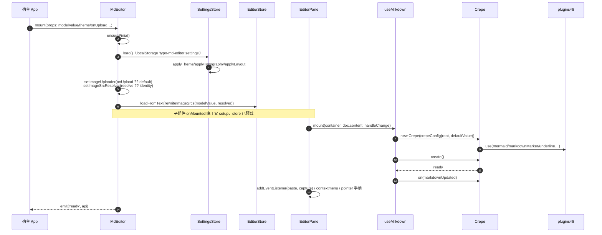
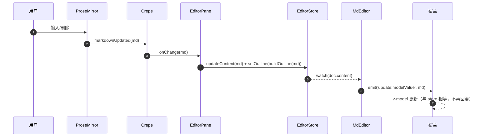
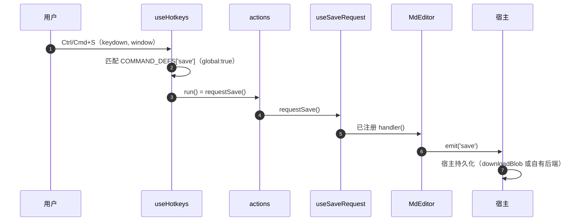
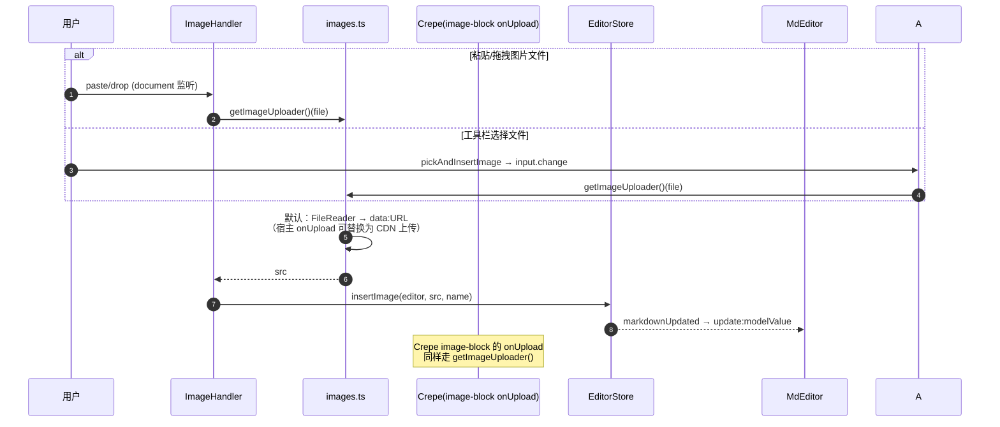
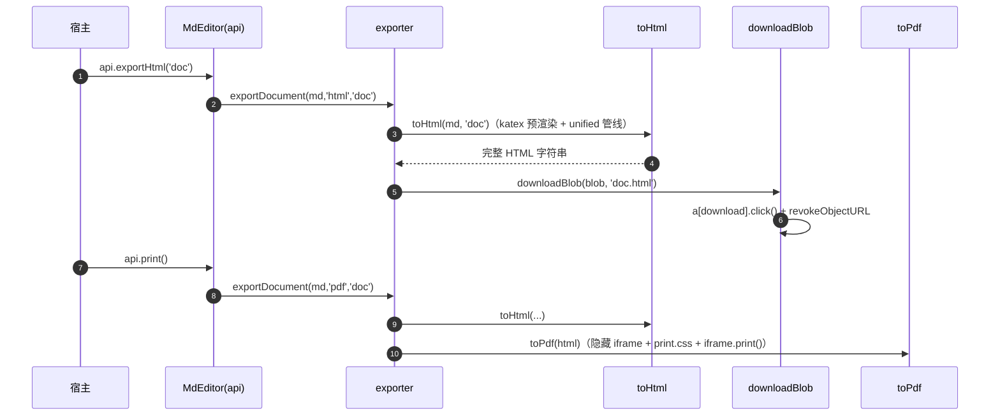
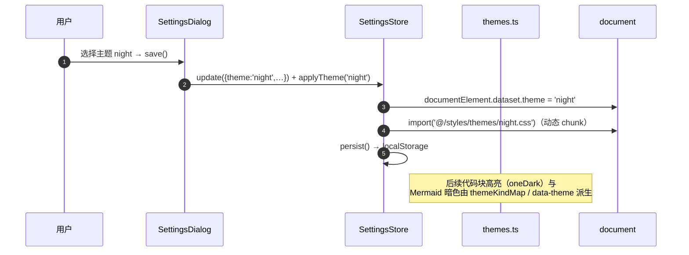
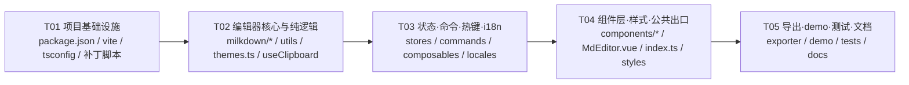

# typo-md-editor 提取架构设计（extraction design）

> 作者：Bob（Architect） · 版本：v1.0 · 日期：2026-10-13
> 源项目：`/home/macro/Work/rust/src/github.com/maczh/typo`（Tauri v2 + Vue3 + Milkdown/Crepe 7）
> 目标包：`/home/macro/Work/js/src/github.com/maczh/typo-md-editor`（纯前端 Vue3 组件包 `typo-md-editor`）

---

## TL;DR

把 typo 桌面应用的**编辑器子系统**（Milkdown/Crepe 内核 + 工具栏 + 右键/块手柄浮层菜单 + 源码模式 + 表格工具条 + 查找/设置/大纲可选组件 + 三语 i18n + 六套主题 + 导出工具）剥离为**零 Tauri 依赖**的 npm 组件包 `typo-md-editor@0.1.0`：

- **解耦策略**：所有文件 IO / 剪贴板 / 持久化 / 图片落盘 / 窗口能力一律从"直接调用 Rust"改为"**宿主回调 / 浏览器 API / 事件**"。保存（Ctrl+S）经 `@save` 事件上交宿主；图片上传经 `onUpload(file)=>Promise<string>` prop 注入（默认 FileReader→data: URL）；本地图片 src 解析经 `resolveImageSrc(src)=>string` 注入（默认恒等）；设置持久化从 Rust settings.json 换为 localStorage。
- **丢弃**（桌面外壳）：主菜单 MenuBar、AppLayout、StatusBar、文件树/侧边栏、命令面板、QuickOpen、自动保存/崩溃恢复、最近文件、窗口标题、全部 `@tauri-apps/*` 与 `invoke` 桥。
- **保留并改造**：编辑器核心（`milkdown/setup.ts` + 8 个插件原样）、动作层 `commands/actions.ts`（删文件/导出菜单动作）、`commands/prose.ts` 原样、stores（editor 改造 / settings 换 localStorage / files 丢弃）、composables（剪贴板删 Tauri 分支、热键裁剪桌面命令、UI 裁剪）、编辑器 6 组件、可选三组件（OutlinePanel / FindDialog / SettingsDialog）、exporter（toHtml/toPdf/toMarkdown 原样可用，index 改浏览器下载）、i18n 三语包原样、styles 六套主题原样。
- **发布形态**：Vite lib mode（ESM + 单 `style.css` + d.ts），`dependencies` 全外部化；内含 `demo/` Vite 应用作为开发调试与回归宿主。
- **验证链**（沙箱 4GB 内存下 vite build 必崩，不作为前提）：`vue-tsc --noEmit` 类型检查 + esbuild 打包探针 + `node:test` 纯逻辑测试；真实 `vite build` 与浏览器回归由用户在自有终端完成。
- **硬约束**：新包 `src/` 中不得出现 `@tauri-apps` / `__TAURI__` / `invoke(` / `convertFileSrc` / `asset://` 任何残留（用 grep 把关）。
- **上游补丁**：`scripts/patch-milkdown-image-block.mjs`（幂等 postinstall，修 `@milkdown/components` image-block `node.title` 为 null 的 RangeError）随包迁移，且必须在**宿主安装时也生效**——npm 会运行依赖的 postinstall，pnpm 需 `approve-builds` 或手动 `patch:milkdown`（README 明示）。

---

# Part A：系统设计

## 1. 实现方案（Implementation Approach）

### 1.1 核心技术难点与选型

| # | 难点 | 方案 | 理由 |
|---|------|------|------|
| 1 | **编辑器内核生命周期**：Crepe 实例的 create/destroy、`loadMarkdown` 用 destroy+重建避免污染 ProseMirror history | 保留源项目 `createEditor()` 薄封装（`EditorInstance` 接口不变），只把 `image-block.onUpload` 从硬编码 `persistImageFile` 改为**可注入** | 这是源项目验证过的稳定行为（含 `loading` 标志防 onChange 回环、capture 阶段 paste 监听做 HTML→MD），重建风险最低 |
| 2 | **Tauri 耦合面广**（9 类耦合点，横跨 stores/composables/commands/utils/exporter） | 按"**边界上收**"原则分层解耦：① 文件 IO → `@save` 事件 + 浏览器 download；② 图片落盘 → `onUpload` prop；③ 本地 src → `resolveImageSrc` prop；④ 设置持久化 → localStorage；⑤ 剪贴板 → 保留 web 回退链删 Tauri 分支；⑥ 窗口标题 → 丢弃（宿主 3 行代码自同步）；⑦ 打开链接 → `window.open` | 每个耦合点有唯一确定答案，工程师无需猜决策（见 §3.3） |
| 3 | **动作层是"上帝模块"**（`actions.ts` 829 行，菜单/工具栏/热键/命令面板统一入口，混入大量桌面动作） | 保留全部**编辑器语义动作**（段落/格式/表格/插入/代码/链接/缩放/主题/源码模式），删除**桌面外壳动作**（打开/保存/删除/导出菜单/侧边栏/命令面板/窗口类），新增 `requestSave()` 走保存事件总线 | 动作层继续作为工具栏/右键菜单/热键三端统一入口，行为与源一致 |
| 4 | **热键注册表**（270 行，含桌面命令） | `COMMAND_DEFS` 裁剪：删 new/open/openFolder/saveAs/quickOpen/commandPalette/close/toggleSidebar/fileTree；保留 save（语义改为 `@save`）、find/replace、preferences（打开设置对话框）、段落/格式/表格/视图缩放/焦点模式；display-only 与表格提示保留 | 热键仍是单一事实源；设置对话框的改键 UI 继续可用 |
| 5 | **主题系统**：6 套主题 × light/dark，`data-theme` 属性 + 动态 CSS 导入 + `isDarkTheme()` 需要 kind 映射（setup.ts 里有一份私有 map） | 新增 `src/themes.ts` 作为**唯一事实源**（THEMES 列表 + themeKindMap + `isDarkThemeId()`），`stores/settings.ts` 与 `milkdown/setup.ts` 都从它导入，删除 setup.ts 私有副本 | 消除"两处 map 不同步"的既有隐患 |
| 6 | **组件包工程化**：既要发 npm 库又要 demo 开发机 | 根 `vite.config.ts` = lib mode（entry `src/index.ts`，formats `['es']`，`cssCodeSplit:false` → 单 `dist/style.css`，`vite-plugin-dts` 产 d.ts，terser 压缩——与源项目相同，规避 esbuild 压缩触发 `@milkdown/components` 循环依赖 TDZ）；`demo/vite.config.ts` = 独立 Vite 应用（`root: demo/`，`@`→`../src`），`npm run dev` 直接跑 demo | 库构建与 demo 构建彻底分离，互不干扰 |
| 7 | **测试与验证受沙箱限制**（RLIMIT_AS=4GB，Node wasm 全挂，vite/esbuild-wasm 不可用） | 验证链 = `vue-tsc --noEmit` + esbuild **原生二进制**打包（`tests/build.mjs` 同源思路）+ `node:test` 纯逻辑单测；`vite build` 只在文档中声明"用户机器执行" | 与源项目 `tests/build.mjs` 已探明的可行路径一致 |
| 8 | **宿主依赖契约**：包内组件依赖 Pinia store 与 vue-i18n 实例 | `src/install.ts` 导出 `typoPlugin`（Vue plugin：装 i18n + 缺省时建 pinia）与 `ensurePinia()`；`MdEditor` setup 内防御性 `ensurePinia()`；README 要求宿主 `app.use(createPinia())` + `app.use(typoPlugin)` | 两种装法都可行，demo 示范标准装法 |

### 1.2 架构模式

分层 + 单向数据流（MVVM，Vue/Pinia 惯例）：

```
宿主应用
  │  props(modelValue/theme/onUpload/…)          emits(update:modelValue/save/ready)
  ▼
┌─────────────────────────────────────────────┐
│ MdEditor.vue（门面：props↔store↔实例同步）    │  ← 唯一公共组件
│   EditorPane.vue（编辑区宿主：挂载/宽度拖拽/    │
│     源码模式/右键菜单/块手柄）                  │
│   Toolbar / TableToolbar / SourceView /       │
│   EditorContextMenu / ImageHandler            │
│   SettingsDialog / FindDialog（可选，内部渲染） │
├─────────────────────────────────────────────┤
│ composables：useMilkdown(单例) useUI useEditor │
│   Menu useSourceMode useFind useClipboard     │
│   useHotkeys useSaveRequest(新增)             │
├─────────────────────────────────────────────┤
│ stores：editor(文档真相) settings(主题/排版)    │
├─────────────────────────────────────────────┤
│ commands：actions(动作层) prose(PM 命令)       │
├─────────────────────────────────────────────┤
│ milkdown：setup.ts(Crepe 工厂) + plugins×8     │
├─────────────────────────────────────────────┤
│ utils：images(重写) import outline file        │
│   markdown toast exporter(×4)                 │
├─────────────────────────────────────────────┤
│ i18n（三语） · styles（variables/app/typora/   │
│   mermaid/print + themes×6） · themes.ts       │
└─────────────────────────────────────────────┘
```

数据流约定：

- **编辑器 → 宿主**：ProseMirror `markdownUpdated` → `onChange` → `editorStore.updateContent(md)` → `MdEditor` watch store → `emit('update:modelValue', md)`。
- **宿主 → 编辑器**：`modelValue` 变化且 ≠ store 内容 → `editorStore.loadFromText()`（`loadSignal++`）→ `EditorPane` watch → `milkdown.loadMarkdown()`。
- **保存**：Ctrl+S → `useHotkeys` → `actions.requestSave()` → `useSaveRequest` 总线 → `MdEditor` 已注册handler → `emit('save')` → 宿主自行持久化（浏览器 download 或自有后端）。
- **编辑器实例访问**：`useMilkdown` 模块级单例（同源项目），`MdEditor` exposes 的 API 是它的稳定门面。

### 1.3 文件清单（目标包结构）

```
typo-md-editor/
├── .gitignore
├── README.md                          # 安装/使用/API/补丁说明/CSP 建议
├── package.json                       # typo-md-editor@0.1.0，ESM+TS
├── tsconfig.json                      # 库 + tests（strict）
├── vite.config.ts                     # ★ lib mode 构建（vite-plugin-dts 产类型）
├── scripts/
│   ├── patch-milkdown-image-block.mjs # 复制：幂等 postinstall 补丁（必须随包）
│   └── prepare-build.cjs              # 复制：构建前清理 dist（规避 bulk-delete）
├── docs/
│   ├── extraction-design.md           # 本设计（主理人落盘）
│   ├── class-diagram.mermaid
│   └── sequence-diagram.mermaid
├── src/
│   ├── index.ts                       # 新增：公共 API 总出口
│   ├── install.ts                     # 新增：typoPlugin / ensurePinia
│   ├── themes.ts                      # 新增：THEMES + themeKindMap（唯一事实源）
│   ├── vite-env.d.ts                  # 改造：删 __TAURI_INTERNALS__ 声明
│   ├── types/
│   │   ├── index.ts                   # 改造：删 Rust 镜像类型/autosave 字段
│   │   └── turndown-plugin-gfm.d.ts   # 复制
│   ├── i18n/
│   │   ├── index.ts                   # 改造：localStorage key 加包名前缀
│   │   └── locales/{zh-CN,en,zh-TW}.ts# 复制（三语包原样，key 不裁剪）
│   ├── styles/
│   │   ├── variables.css              # 复制
│   │   ├── app.css                    # 改造：删 .app-layout/.app-body/.editor-area
│   │   ├── typora.css                 # 复制
│   │   ├── mermaid.css                # 复制
│   │   ├── print.css                  # 复制（toPdf 的 ?url 目标）
│   │   └── themes/{github,gothic,newsprint,night,pixyll,whitey}.css  # 复制×6
│   ├── milkdown/
│   │   ├── setup.ts                   # 改造：onUpload 注入 + themes.ts
│   │   └── plugins/{mermaid,table,highlight,latex,image,underline,
│   │       markdownMarker,mermaidTemplates}.ts   # 复制×8（零 Tauri 耦合）
│   ├── composables/
│   │   ├── useMilkdown.ts             # 改造：mount 签名兼容 + 单例保留
│   │   ├── useUI.ts                   # 改造：裁剪为 sourceMode/findOpen/settingsOpen
│   │   ├── useEditorMenu.ts           # 复制
│   │   ├── useSourceMode.ts           # 复制
│   │   ├── useFind.ts                 # 改造：去掉 useUI 依赖（close 由组件管）
│   │   ├── useClipboard.ts            # 改造：删 Tauri 分支，保留 web 回退链
│   │   ├── useHotkeys.ts              # 改造：COMMAND_DEFS 删桌面命令
│   │   └── useSaveRequest.ts          # 新增：保存请求总线（Ctrl+S→@save）
│   ├── commands/
│   │   ├── actions.ts                 # 改造：删文件/导出/Tauri 动作（§3.3-3）
│   │   └── prose.ts                   # 复制（仅 asset:// 注释微调）
│   ├── stores/
│   │   ├── editor.ts                  # 改造：EditorDoc 去 path；store id 改 typo-editor
│   │   └── settings.ts                # 改造：localStorage 持久化 + themes.ts
│   ├── utils/
│   │   ├── images.ts                  # 重写：默认上传 + src 重写（§3.3-2）
│   │   ├── import.ts                  # 复制（turndown HTML→MD）
│   │   ├── outline.ts                 # 复制
│   │   ├── file.ts                    # 复制并删 nativeJoin（仅 Tauri 路径用）
│   │   ├── markdown.ts                # 复制
│   │   ├── toast.ts                   # 复制（registerToast 的调用方消失，函数保留）
│   │   └── exporter/
│   │       ├── index.ts               # 改造：downloadBlob + print（§3.3-8）
│   │       ├── toHtml.ts              # 复制
│   │       ├── toPdf.ts               # 复制（iframe+print.css?url，已纯 web）
│   │       └── toMarkdown.ts          # 复制
│   └── components/
│       ├── MdEditor.vue               # 新增：主组件（§2 公共 API）
│       ├── common/{Icon.vue,icons.ts} # 复制×2
│       ├── editor/
│       │   ├── EditorPane.vue         # 复制（依赖全部存活；store 预载后挂载）
│       │   ├── Toolbar.vue            # 复制
│       │   ├── EditorContextMenu.vue  # 复制
│       │   ├── ImageHandler.vue       # 改造：persistImageFile → 上传器
│       │   ├── SourceView.vue         # 复制
│       │   └── TableToolbar.vue       # 复制
│       ├── dialogs/
│       │   ├── SettingsDialog.vue     # 改造：open 外置 + 删 autoSave 字段
│       │   └── FindDialog.vue         # 改造：open 外置（modelValue/close）
│       └── sidebar/
│           └── OutlinePanel.vue       # 复制（读 editor store，滚动 .milkdown）
├── demo/                              # 开发调试 + 回归宿主（Vite 应用）
│   ├── index.html                     # 新增（CSP：去 asset:，留 data:/blob:/wasm）
│   ├── vite.config.ts                 # 新增（root=demo，@→../src，端口 1420）
│   ├── tsconfig.json                  # 新增
│   ├── env.d.ts                       # 新增（vite/client）
│   ├── main.ts                        # 新增（pinia + typoPlugin + CSS 顺序）
│   ├── App.vue                        # 新增（宿主外壳：工具栏/大纲/对话框/导入导出）
│   └── style.css                      # 新增
└── tests/
    ├── build.mjs                      # 复制并删 exporter-toDocx 条目
    ├── file.test.ts                   # 复制
    ├── outline.test.ts                # 复制
    ├── i18n.test.ts                   # 复制
    ├── exporter-toHtml.test.ts        # 复制
    └── exporter-toMarkdown.test.ts    # 复制
```

**丢弃清单**（不进入目标包）：`src/main.ts`、`src/App.vue`、`src/components/layout/*`（5）、`src/components/sidebar/{FileTree,TreeItem,SideBar}.vue`、`src/components/command/CommandPalette.vue`、`src/components/dialogs/{QuickOpenDialog,RecoveryDialog}.vue`、`src/composables/{useTauri,useAutosave,useRecentFiles,useQuickOpen,useWindowTitle}.ts`、`src/stores/files.ts`、`tests/exporter-toDocx.test.ts`（源项目即引用不存在的 `toDocx`，坏测试）、`tests/e2e-*.mjs`（依赖 puppeteer + 运行中的 dev server）、`src-tauri/**`、根 `index.html`。

---

## 2. 公共 API 设计

### 2.1 主组件 `MdEditor.vue`

**Props**

| Prop | 类型 | 默认 | 说明 |
|------|------|------|------|
| `modelValue` | `string` | `''` | v-model：Markdown 双向绑定（编辑器真相源） |
| `theme` | `string` | `'github'` | 主题 id（`github/gothic/newsprint/night/pixyll/whitey`）；变化时热切换 |
| `language` | `Lang` | `'zh-CN'` | `zh-CN / en / zh-TW` |
| `readonly` | `boolean` | `false` | 只读（`crepe.setReadonly(true)`）；为 true 时隐藏工具栏 |
| `showToolbar` | `boolean` | `true` | 顶部格式工具栏开关 |
| `showTableToolbar` | `boolean` | `true` | 表格浮动工具条开关（传给 EditorPane） |
| `showContextMenu` | `boolean` | `true` | 右键菜单 + 块手柄浮层开关 |
| `hotkeys` | `boolean` | `true` | 注册全局热键（窗口级 keydown） |
| `contentWidth` | `number` | `80` | 内容栏宽度百分比（30–100，拖拽写回设置） |
| `fontSize` | `number` | `16` | 正文字号 px |
| `lineHeight` | `number` | `1.6` | 行高 |
| `fontFamily` | `string` | settings 默认 | 字体栈 |
| `customCss` | `string` | `''` | 用户自定义 CSS（注入 `<style id="typo-custom-css">`） |
| `onUpload` | `(file: File) => Promise<string>` | `fileToDataUrl` | 图片上传回调（粘贴/拖拽/选择文件/`image-block.onUpload` 统一走它）；返回插入用 src |
| `resolveImageSrc` | `(src: string) => string` | 恒等 | 本地图片 src 显示解析（装载/loadMarkdown 时重写 md 中的引用）；默认恒等 = 相对路径原样渲染 |

> props 语义：**首次挂载 = 初始值；后续变化 = 受控同步**（watch 写入设置 store 或编辑器）。
> `resolveImageSrc` 注意：重写后的 src 会经 `getMarkdown()`/v-model 回流给宿主；若宿主做了前缀映射，请在 `@save` 时自行映射回相对路径（默认恒等时零影响）。

**Emits**

| 事件 | 载荷 | 触发时机 |
|------|------|----------|
| `update:modelValue` | `string` | 编辑器内容变化（输入、源码模式提交、查找替换） |
| `save` | – | 用户触发保存（Ctrl/Cmd+S 热键或动作层 `requestSave()`）；宿主负责持久化 |
| `ready` | `EditorApi` | 编辑器实例创建完成（可提前拿 API） |

**Exposes（`EditorApi`，模板 ref / `ready` 事件均可获得）**

| 方法 | 签名 | 说明 |
|------|------|------|
| `getMarkdown` | `() => Promise<string>` | 取当前 Markdown（Crepe 序列化） |
| `getHTML` | `() => string` | 取当前 HTML（同步，与源一致） |
| `loadMarkdown` | `(md: string) => void` | 整体重载（destroy+重建实例） |
| `insert` | `(md: string) => void` | 在光标处插入 Markdown 片段 |
| `focus` | `() => void` | 焦点回到编辑区 |
| `destroy` | `() => void` | 销毁实例 |
| `getEditor` | `() => Editor \| null` | 底层 Milkdown `Editor`（高级用法） |
| `setReadonly` | `(v: boolean) => void` | 运行时切换只读 |
| `exportMarkdown` | `(filename?: string) => void` | 浏览器下载 `.md`（默认 `untitled.md`） |
| `exportHtml` | `(filename?: string) => Promise<void>` | 生成自包含 HTML 并下载（KaTeX 内联） |
| `print` | `() => Promise<void>` | 隐藏 iframe + `print.css` 调起打印（用户选"另存为 PDF"） |
| `openSettings` | `() => void` | 打开内置设置对话框（主题/语言/排版/改键/自定义 CSS） |
| `openFind` | `() => void` | 打开内置查找替换栏 |

**Slots**

| 插槽 | 作用 |
|------|------|
| `toolbar` | 覆盖默认工具栏（传自定义按钮组；仍可用包导出的 `editorActions`） |

**公开导出的配套组件/composable**（宿主自由组合，非 MdEditor 内部）：

| 导出 | 用途 |
|------|------|
| `OutlinePanel` | 大纲面板（读内部 editor store 的 outline；点击平滑滚动并高亮标题） |
| `SettingsDialog` | 设置对话框（也可由 MdEditor 内部渲染；导出供宿主自布位置） |
| `FindDialog` | 查找替换栏（同上） |
| `useMilkdown` / `useFind` / `useHotkeys` / `useEditorMenu` | 组合式入口 |
| `useEditorStore` / `useSettingsStore` | 状态读取（如宿主自同步 `document.title`） |
| `editorActions`（命名空间导出） | 全部编辑器动作（`editorActions.toggleBold()` 等） |
| `THEMES` / `isDarkThemeId` / `typoPlugin` / `typoI18n` / `SUPPORTED_LANGS` | 主题目录、Vue 插件、i18n 实例 |
| `toHtml` / `toMarkdown` / `toPdf` / `exportDocument` / `downloadBlob` | 导出工具 |
| `fileToDataUrl` / `rewriteImageSrcs` / `buildOutlineFromMarkdown` | 图片/大纲纯函数 |
| 类型：`EditorInstance` `EditorApi` `Settings` `ThemeDef` `Lang` `EditorMode` `OutlineNode` `HotkeySpec` `ExportFormat` `ThemeKind` `ImageUploader` | TS 消费 |

**最小用法**：

```vue
<script setup>
import { createApp } from 'vue'
import { createPinia } from 'pinia'
import { MdEditor, typoPlugin } from 'typo-md-editor'
import 'typo-md-editor/style.css'
const app = createApp(App)
app.use(createPinia()).use(typoPlugin).mount('#app')
</script>
<template>
  <MdEditor v-model="md" theme="night" @save="onSave" :on-upload="uploadToMyCdn" />
</template>
```

### 2.2 markdown 双向绑定与只读

- v-model：唯一真相源是 Markdown 字符串；编辑器每次 `markdownUpdated` → store → emit。
- `readonly`：调 `crepe.setReadonly(true)`（Crepe 公开 API，已核实存在于 `@milkdown/crepe/lib/types/core/builder.d.ts`），同时隐藏工具栏、禁用右键菜单动作入口（菜单仍可开但动作对只读文档执行前会被 PM 拒绝——与源行为一致，不做额外拦截）。

### 2.3 主题

- 6 套主题 + light/dark：`THEMES`（`themes.ts`）为唯一目录；`applyTheme(id)` 写 `document.documentElement.dataset.theme` 并动态 `import()` 对应主题 CSS。
- 代码块高亮主题：`setup.ts` 的 `isDarkTheme()` 改读 `themes.ts` 的 `themeKindMap`（删除源里的私有副本）。
- Mermaid 亮/暗：`currentMermaidTheme()` 仍读 `data-theme` 属性（运行时 DOM 事实，保留源实现）。

---

## 3. 逐文件映射表与解耦方案

> 动作图例：**复制** = 原样拷贝；**改造** = 拷贝后按下表修改；**重写** = 同路径新实现；**新增** = 目标包新文件；**丢弃** = 不迁移。

### 3.1 映射总表

| # | 源文件 | 目标路径 | 动作 | 说明 |
|---|--------|----------|------|------|
| 1 | `src/milkdown/plugins/mermaid.ts` | 同 | 复制 | 零 Tauri 耦合（动态 import mermaid，jsdom 不可用仅影响测试，不影响库） |
| 2 | `src/milkdown/plugins/table.ts` | 同 | 复制 | |
| 3 | `src/milkdown/plugins/highlight.ts` | 同 | 复制 | |
| 4 | `src/milkdown/plugins/latex.ts` | 同 | 复制 | |
| 5 | `src/milkdown/plugins/image.ts` | 同 | 复制 | |
| 6 | `src/milkdown/plugins/underline.ts` | 同 | 复制 | |
| 7 | `src/milkdown/plugins/markdownMarker.ts` | 同 | 复制 | |
| 8 | `src/milkdown/plugins/mermaidTemplates.ts` | 同 | 复制 | |
| 9 | `src/milkdown/setup.ts` | 同 | 改造 | 见 3.3-7 |
| 10 | `src/composables/useMilkdown.ts` | 同 | 改造 | mount 增 `onUpload` 透传；保留 `?e2e=1` → `window.__typo` 探针 |
| 11 | `src/composables/useEditorMenu.ts` | 同 | 复制 | |
| 12 | `src/composables/useSourceMode.ts` | 同 | 复制 | |
| 13 | `src/composables/useFind.ts` | 同 | 改造 | 删 `useUI` 依赖；`close()` 保留供组件调用 |
| 14 | `src/composables/useUI.ts` | 同 | 改造 | 只留 `sourceMode/findOpen/settingsOpen` + 开关方法；删 sidebar/recovery/quickOpen/commandPalette/statusBar |
| 15 | `src/composables/useClipboard.ts` | 同 | 改造 | 见 3.3-4 |
| 16 | `src/composables/useHotkeys.ts` | 同 | 改造 | 见 3.3-6 |
| 17 | `src/commands/prose.ts` | 同 | 复制 | 仅将 `replaceImageSrc` 处 asset:// 注释改为中性描述 |
| 18 | `src/commands/actions.ts` | 同 | 改造 | 见 3.3-3 |
| 19 | `src/stores/editor.ts` | 同 | 改造 | `EditorDoc` 去 `path`；store id `editor`→`typo-editor` |
| 20 | `src/stores/settings.ts` | 同 | 改造 | 见 3.3-5；store id `settings`→`typo-settings`；`load()` 不再 async 依赖 invoke（仍返回 Promise 保持接口） |
| 21 | `src/utils/images.ts` | 同 | 重写 | 见 3.3-2 |
| 22 | `src/utils/import.ts` | 同 | 复制 | |
| 23 | `src/utils/outline.ts` | 同 | 复制 | |
| 24 | `src/utils/file.ts` | 同 | 复制并删 `nativeJoin` | 其余三函数被测试覆盖，保留 |
| 25 | `src/utils/markdown.ts` | 同 | 复制 | |
| 26 | `src/utils/toast.ts` | 同 | 复制 | |
| 27 | `src/utils/exporter/index.ts` | 同 | 改造 | 见 3.3-8 |
| 28 | `src/utils/exporter/toHtml.ts` | 同 | 复制 | |
| 29 | `src/utils/exporter/toPdf.ts` | 同 | 复制 | |
| 30 | `src/utils/exporter/toMarkdown.ts` | 同 | 复制 | |
| 31 | `src/components/editor/EditorPane.vue` | 同 | 复制 | 依赖全部存活；`showTableToolbar/showContextMenu` 由 MdEditor 经 props 注入（微调：两处 `v-if` 改读 props） |
| 32 | `src/components/editor/Toolbar.vue` | 同 | 复制 | |
| 33 | `src/components/editor/EditorContextMenu.vue` | 同 | 复制 | |
| 34 | `src/components/editor/ImageHandler.vue` | 同 | 改造 | `persistImageFile` → `getImageUploader()(file)` |
| 35 | `src/components/editor/SourceView.vue` | 同 | 复制 | |
| 36 | `src/components/editor/TableToolbar.vue` | 同 | 复制 | |
| 37 | `src/components/common/Icon.vue` + `icons.ts` | 同 | 复制 | |
| 38 | `src/components/sidebar/OutlinePanel.vue` | `src/components/sidebar/OutlinePanel.vue` | 复制 | 从 `sidebar/` 平级保留（目录名不改，减少 diff） |
| 39 | `src/components/dialogs/SettingsDialog.vue` | 同 | 改造 | open 外置；删 autoSave/autoSaveInterval 表单项 |
| 40 | `src/components/dialogs/FindDialog.vue` | 同 | 改造 | open 外置（`modelValue` + `@close`） |
| 41 | `src/i18n/index.ts` | 同 | 改造 | lang 存储 key `typo-lang` → `typo-md-editor:lang` |
| 42 | `src/i18n/locales/{zh-CN,en,zh-TW}.ts` | 同 | 复制 | 含已废弃功能 key 也保留（三语一致性测试依赖全 key 对齐；v0.1 接受冗余） |
| 43 | `src/styles/variables.css` | 同 | 复制 | |
| 44 | `src/styles/typora.css` | 同 | 复制 | |
| 45 | `src/styles/mermaid.css` | 同 | 复制 | |
| 46 | `src/styles/print.css` | 同 | 复制 | |
| 47 | `src/styles/themes/*.css`（6） | 同 | 复制 | |
| 48 | `src/styles/app.css` | 同 | 改造 | 删 `.app-layout/.app-body/.editor-area`（应用外壳布局）；保留 `*` reset、html/body 100%、`.btn/.icon-btn/.dialog*/.toast*`、滚动条 |
| 49 | `src/types/index.ts` | 同 | 改造 | 删 `FileResult/SaveResult/RecoveryItem/FileItem/RecentItem/OpenKind/AssetWriteResult/CommandItem`；`EditorDoc` 去 path；`Settings` 删 `autoSave/autoSaveInterval`；保留 `Lang/EditorMode/ThemeKind/OutlineNode/HotkeySpec/Settings/ThemeDef/ExportFormat` |
| 50 | `src/types/turndown-plugin-gfm.d.ts` | 同 | 复制 | |
| 51 | `src/vite-env.d.ts` | 同 | 改造 | 删 `__TAURI_INTERNALS__` 的 Window 声明 |
| 52 | `scripts/patch-milkdown-image-block.mjs` | 同 | 复制 | **必须**；postinstall 对宿主生效（见风险 R5） |
| 53 | `scripts/prepare-build.cjs` | 同 | 复制 | 非 Tauri 相关；规避 bulk-delete 守卫 |
| 54 | `tests/build.mjs` | 同 | 改造 | entries 删 `exporter-toDocx.test.ts` |
| 55 | `tests/{file,outline,i18n,exporter-toHtml,exporter-toMarkdown}.test.ts` | 同 | 复制 | 5 个纯逻辑测试 |
| 56 | `src/components/editor/*` 中 EditorPane | 同 | 复制 | 见 #31 |
| 57 | `src/main.ts`、`src/App.vue` | – | 丢弃 | 应用入口；职责迁 `demo/main.ts` |
| 58 | `src/components/layout/*`（AppLayout/MenuBar/MenuNode/menuTypes/StatusBar） | – | 丢弃 | 应用主菜单/布局/状态栏属桌面外壳 |
| 59 | `src/components/sidebar/{FileTree,TreeItem,SideBar}.vue` | – | 丢弃 | 文件树需目录 IO |
| 60 | `src/components/command/CommandPalette.vue` | – | 丢弃 | 依赖 files store + Tauri |
| 61 | `src/components/dialogs/{QuickOpenDialog,RecoveryDialog}.vue` | – | 丢弃 | 桌面外壳 |
| 62 | `src/composables/{useTauri,useAutosave,useRecentFiles,useQuickOpen,useWindowTitle}.ts` | – | 丢弃 | invoke 桥/自动保存/最近文件/快速打开/窗口标题 |
| 63 | `src/stores/files.ts` | – | 丢弃 | 目录树 + 最近文件 |
| 64 | `index.html` | `demo/index.html` | 改造迁移 | CSP 去 `asset:`/`http://asset.localhost`，保留 `data: blob: https:` 与 `wasm-unsafe-eval` |
| 65 | `vite.config.ts` | 根 `vite.config.ts`（新）+ `demo/vite.config.ts`（新） | 重写 | 根 = lib mode；demo = 应用配置（端口 1420/1421、optimizeDeps 同源） |
| 66 | `tsconfig.json` | 根（新）+ `demo/tsconfig.json`（新） | 重写 | 根含 `src/**` + `tests/**` |
| 67 | `package.json` | 根（新） | 重写 | 见 §4 |
| 68 | – | `src/index.ts` | 新增 | 公共 API 出口（§2.1 导出清单） |
| 69 | – | `src/install.ts` | 新增 | `typoPlugin` + `ensurePinia()` |
| 70 | – | `src/themes.ts` | 新增 | `THEMES` / `themeKindMap` / `isDarkThemeId` / `DEFAULT_THEME` |
| 71 | – | `src/components/MdEditor.vue` | 新增 | 主组件（§2.1） |
| 72 | – | `src/composables/useSaveRequest.ts` | 新增 | 保存事件总线 |
| 73 | – | `demo/{index.html,vite.config.ts,tsconfig.json,env.d.ts,main.ts,App.vue,style.css}` | 新增 | 回归宿主 |
| 74 | – | `README.md`、`.gitignore` | 新增 | 使用文档/忽略规则 |

### 3.2 新增文件规格

**`src/themes.ts`**（新）：
```ts
export interface ThemeDef { id: string; name: string; kind: 'light' | 'dark' }
export const THEMES: ThemeDef[] = [
  { id: 'github', name: 'Github', kind: 'light' },
  { id: 'gothic', name: 'Gothic', kind: 'dark' },
  { id: 'newsprint', name: 'Newsprint', kind: 'light' },
  { id: 'night', name: 'Night', kind: 'dark' },
  { id: 'pixyll', name: 'Pixyll', kind: 'light' },
  { id: 'whitey', name: 'Whitey', kind: 'light' },
]
export const DEFAULT_THEME = 'github'
export const themeKindMap: Record<string, 'light' | 'dark'> = /* 由 THEMES 派生 */
export function isDarkThemeId(id: string): boolean
```

**`src/install.ts`**（新）：
```ts
import type { App } from 'vue'
import { createPinia, getActivePinia, setActivePinia } from 'pinia'
import { i18n as typoI18n } from './i18n'
export function ensurePinia(): void {
  if (!getActivePinia()) setActivePinia(createPinia())   // pinia@2.3 已核实导出二者
}
export const typoPlugin = {
  install(app: App): void { ensurePinia(); app.use(typoI18n) },
}
```

**`src/composables/useSaveRequest.ts`**（新）：模块级 handler 单例；`registerSaveHandler(fn)/unregisterSaveHandler()/requestSave()`；`actions.requestSave()` 调 `requestSave()`；`MdEditor` onMounted 注册 `() => emit('save')`、onBeforeUnmount 反注册。

**`src/utils/images.ts`**（重写，全文规格）：
```ts
export type ImageUploader = (file: File) => Promise<string>

/** 默认上传器：FileReader → data: URL（纯浏览器，不落盘） */
export function fileToDataUrl(file: File): Promise<string>
export const defaultUploader: ImageUploader

/** 上传器 / src 解析器注入点（MdEditor 据 props 设置，卸载时恢复默认） */
export function setImageUploader(fn: ImageUploader): void
export function getImageUploader(): ImageUploader
export function setImageSrcResolver(fn: (src: string) => string): void
export function getImageSrcResolver(): (src: string) => string

/** 复用源项目的 md/html img 正则机器（collectSrcs/unwrapRef），纯函数重写引用 */
export function collectImageSrcs(md: string): string[]
export function rewriteImageSrcs(md: string, resolve: (src: string) => string): string
```
删除：`persistImageFile/localizeMarkdown/prepareImagesForSave/downloadBytes/fetch_remote_image/assetUrlToRelative/fsRelative/nativeJoin 依赖/mimeToExt/sanitizeName/extFromUrl`（磁盘物化整体移除）。**远程图片（http/https）在纯前端包里不做落盘物化**——默认原样引用；宿主如需本地化，在 `@save` 事件里自行处理（README 说明）。

**`src/components/MdEditor.vue`**（新，结构规格）：
```vue
<script setup lang="ts">
// props/emits 见 §2.1；setup 内：
//  1. ensurePinia()
//  2. props → settingsStore（theme/language/fontSize/lineHeight/fontFamily/customCss/contentWidth）
//     + settingsStore.load()（localStorage）→ applyTheme/applyTypography/applyLayout
//  3. setImageUploader(props.onUpload ?? defaultUploader)；setImageSrcResolver(props.resolveImageSrc ?? identity)
//  4. editorStore.loadFromText(rewriteImageSrcs(props.modelValue, resolver))   // 同步，早于子组件 onMounted
//  5. watch(modelValue) ≠ store.content → loadFromText（触发 loadSignal → EditorPane 重载）
//  6. watch(editorStore.doc.content) ≠ props.modelValue → emit update:modelValue
//  7. watch(theme/language/…) → 对应 apply*；watch(readonly) → instance.setReadonly
//  8. if (props.hotkeys) useHotkeys()
//  9. onMounted: registerSaveHandler(() => emit('save'))；onBeforeUnmount: 反注册 + 恢复默认注入
</script>
<template>
  <div class="md-editor">
    <slot name="toolbar">
      <Toolbar v-if="showToolbar && !readonly" />
    </slot>
    <EditorPane :show-table-toolbar="showTableToolbar" :show-context-menu="showContextMenu" />
    <SettingsDialog v-if="ui.settingsOpen" @close="ui.closeSettings()" />
    <FindDialog v-if="ui.findOpen" @close="ui.closeFind()" />
  </div>
</template>
```

**`demo/App.vue`**（新，回归宿主必备元素）：顶部宿主按钮组（导入 .md `<input type=file>`、保存=下载、导出 HTML、打印/PDF、打开设置、打开查找、主题下拉、语言下拉、只读勾选、工具栏/热键开关勾选）；左侧 `MdEditor`；右侧 `OutlinePanel`；底部状态行（字数/脏标记 —— 示范宿主如何读 `useEditorStore`）；`document.title` 同步示范（watch doc.name/dirty，3 行，替代被丢弃的 useWindowTitle）。

### 3.3 Tauri 耦合点解耦明细（逐条落地方案）

**3.3-1 `composables/useTauri.ts`（invoke 桥）→ 整文件删除**
调用方分类处置：
- `stores/settings.ts` load/persist → localStorage（3.3-5）
- `stores/files.ts`、`useAutosave/useRecentFiles/useQuickOpen`、`AppLayout`、`CommandPalette`、`RecoveryDialog` → 随文件丢弃
- `commands/actions.ts` 的文件动作 → 删除（3.3-3）
- `utils/exporter/index.ts` pickSave/saveFileAs → downloadBlob（3.3-8）
- `main.ts` 的 `registerToast` → 随 main.ts 丢弃；`utils/toast.ts` 无依赖直用
- `isTauri()` 的其它消费方（images/actions/useClipboard/useWindowTitle）→ 随各自改造消失

**3.3-2 `utils/images.ts` → 重写**（规格见 3.2）。关键决策：
- `convertFileSrc`/`asset://` 双向转换（localizeMarkdown/prepareImagesForSave）**整体删除**；显示期解析由 `resolveImageSrc` prop 注入（默认恒等，相对路径原样渲染）。
- `invoke('fetch_remote_image')` 远程图片下载落盘 **删除**（纯前端不做远程物化）。
- `persistImageFile(file, docPath)` → `getImageUploader()(file)`（默认 data: URL）。Crepe `image-block.onUpload`、`ImageHandler` 粘贴/拖拽、`actions.pickAndInsertImage` 三处统一走它。
- 保留 `MD_IMG_RE/HTML_IMG_RE/collectSrcs/unwrapRef` 正则机器供 `rewriteImageSrcs` 使用（原样拷贝，已测过边界）。

**3.3-3 `commands/actions.ts` → 改造**
- 删：`newFile/newWindow/openFileDialog/openFolderDialog/quickOpen/saveFile/saveFileAs/deleteCurrentFile/saveAll/revealFileInFolder/closeWindow/persistAndSave/exportAs/printDocument/toggleSidebar/showOutlinePanel/showFileTreePanel/openSearchPanel/toggleStatusBar/alwaysOnTop/switchInAppWindow/devTools/openCommandPalette/openPreferences/globalImageSettings/setImageRoot/setImageInsertMode/insertFromIPhone/copyAllImages/moveAllImages/uploadAllImages`、`requireTauri`。
- 改：`openLink` → `window.open(href,'_blank')`（删 plugin-opener 动态 import）；`pickAndInsertImage` → `getImageUploader()`（删 writeAsset/convertFileSrc/nativeJoin/dirname）；`openFind` → `useUI().openFind()`（保留）；`openPreferences` → 内部 `useUI().openSettings()`（由 MdEditor 渲染 SettingsDialog）。
- 增：`requestSave()` → `useSaveRequest.requestSave()`。
- 留：全部编辑器语义动作（undo/redo/cut/copy/paste/copyAsMarkdown/pasteAsPlainText/selectAll/restoreSelection/focusEditor/deleteSelection/setHeading/setParagraph/inc/dec/insertTable/table*/insertCodeBlock/代码工具/alert/task/math/quote/lists/indent/paraAbove|Below/linkReference/footnote/hr/toc/yaml/diagram*/toggle{Bold,Italic,Underline,InlineCode,Strike}/insertComment/insertHyperlink/clearStyle/link 三态/insertLocalImage/insertRemoteImage/reloadAllImages/toggleSourceMode/setMode/focus|typewriter/zoom*/applyTheme/setLanguage/currentBlockType/currentHeadingLevel/markActive/nodeActive）。
- import 清理：`useTauri/isTauri/convertFileSrc/@tauri-apps/plugin-opener/prepareImagesForSave/exportDocument/nativeJoin/dirname` 全部移除；`exportAs/printDocument` 的导出能力改由 MdEditor exposes 的 `exportMarkdown/exportHtml/print` 提供。

**3.3-4 `useClipboard.ts` → 改造**：删 `isTauri()` 分支与 `@tauri-apps/plugin-clipboard-manager` 动态 import；保留 `navigator.clipboard.writeText/readText` + `legacyWrite`（隐藏 textarea + execCommand）两级 web 回退链；文件头注释改为"浏览器环境说明"。

**3.3-5 `stores/settings.ts` → 改造**：
- `load()`：`localStorage.getItem('typo-md-editor:settings')` → JSON.parse → `Object.assign(settings, s)`（try/catch 回落默认）；legacy 主题 id 迁移（`github-light→github`、`nord-dark→night`）保留；随后 applyTheme/setLanguage/applyTypography/applyLayout/applyCustomCss。
- `persist()`：`localStorage.setItem('typo-md-editor:settings', JSON.stringify(settings))`（try/catch）。
- 删 `useTauri` import；`themes` 列表改 import `../themes`（THEMES）。
- `Settings` 类型删 `autoSave/autoSaveInterval`（包内无自动保存）。
- `applyTheme/applyTypography/applyLayout/applyCustomCss/setLanguage` 原样保留（documentElement/CSS 变量/`<style id="typo-custom-css">` 注入）。

**3.3-6 `useHotkeys.ts` → 改造**：
- `COMMAND_DEFS` 删 9 条桌面命令（new/open/openFolder/saveAs/quickOpen/commandPalette/close/toggleSidebar/fileTree）；`save` 的 `run` 改为 `A.requestSave`；`preferences` 的 `run` 保持 `A.openPreferences`（打开设置对话框）。
- `dialogsOpen` 判断改为只查 `ui.settingsOpen/ui.findOpen`。
- `formatHotkey/specFromEvent/sameHotkey/getEffectiveHotkeys/DEFAULT_HOTKEYS/REBINDABLE/isField` 原样保留（设置对话框改键 UI 依赖）。
- `useHotkeys()` 仍返回 void、onMounted/onBeforeUnmount 挂窗口监听（由 MdEditor 按 `hotkeys` prop 条件调用）。

**3.3-7 `milkdown/setup.ts` → 改造**：
- `CreateOptions` 增 `onUpload?: ImageUploader`；`crepeConfig` 的 `image-block.onUpload` 改为 `options.onUpload ?? defaultUploader`（从 `utils/images` 导入默认）；删动态 import editor store 取 docPath 的逻辑（无磁盘路径）。
- `isDarkTheme()` 改 import `themeKindMap` from `@/themes`；删文件内私有 map 与循环依赖注释。
- `EditorInstance` 接口保留（getMarkdown/getHTML/loadMarkdown/destroy/insert/getEditor/focus），并增 `setReadonly(v: boolean)`（透传 `crepe.setReadonly`，已核实存在）。
- paste capture 监听、`loading` 标志、spawn/attach/destroy 逻辑原样。

**3.3-8 `utils/exporter/*` → 改造 index，其余复制**：
- `exportDocument(md, format, baseName)`：`markdown` → `downloadBlob(new Blob([toMarkdown(md)]), base+'.md')`；`html` → `downloadBlob(..., base+'.html')`；`pdf` → `toPdf(await toHtml(md, base))`（iframe+print，已纯 web）。删 `useTauri/pickSave/saveFileAs`。
- `downloadBlob` 原样保留（a[download] + objectURL，浏览器通用）。
- `toPdf.ts` 复制（`print.css?url` 在 vite lib/demo 均可用）；`toHtml.ts`（katex `?raw` 内联）与 `toMarkdown.ts` 复制。

**3.3-9 其余**：
- `index.html` → `demo/index.html`：CSP 的 `img-src` 去 `asset:` 与 `http://asset.localhost`，保留 `data: blob: https:`；`script-src` 保留 `'unsafe-eval' 'wasm-unsafe-eval'`（mermaid）；`connect-src` 去 tauri 相关保留 `ws://localhost:*`。
- `vite.config.ts` → 拆成根（lib）与 demo 两份；删 `envPrefix: ['VITE_','TAURI_']` 的 TAURI_、删 tauri 注释；`base: './'` 保留；`minify: 'terser'` 保留（重要：规避 `@milkdown/components` 循环依赖 TDZ）。
- `vite-env.d.ts` → 删 `__TAURI_INTERNALS__` Window 声明。
- `types/index.ts` → 删 Rust 镜像类型（见映射 #49）；`EditorDoc.path` 删除后，`stores/editor.ts` 的 `loadFromText(text, name)` 签名同步改。
- `useWindowTitle` → 丢弃；README + demo 示范 `watch(() => [doc.name, doc.dirty], () => document.title = ...)`。

---

## 4. 依赖清单（新 package.json）

```json
{
  "name": "typo-md-editor",
  "version": "0.1.0",
  "description": "纯前端 Vue3 WYSIWYG Markdown 编辑器组件（Milkdown/Crepe 内核，零 Tauri 依赖）",
  "type": "module",
  "license": "MIT",
  "files": ["dist", "docs"],
  "sideEffects": ["*.css"],
  "main": "./dist/typo-md-editor.js",
  "module": "./dist/typo-md-editor.js",
  "types": "./dist/index.d.ts",
  "exports": {
    ".": { "types": "./dist/index.d.ts", "import": "./dist/typo-md-editor.js" },
    "./style.css": "./dist/style.css",
    "./package.json": "./package.json"
  },
  "scripts": {
    "dev": "vite --config demo/vite.config.ts",
    "build:lib": "vue-tsc --noEmit && node scripts/prepare-build.cjs dist && vite build",
    "build:demo": "vite build --config demo/vite.config.ts",
    "build": "npm run build:lib && npm run build:demo",
    "typecheck": "vue-tsc --noEmit",
    "test": "node tests/build.mjs && node --test tests/.out/",
    "postinstall": "node scripts/patch-milkdown-image-block.mjs",
    "patch:milkdown": "node scripts/patch-milkdown-image-block.mjs"
  },
  "dependencies": {
    "@codemirror/theme-one-dark": "^6.1.3",
    "@milkdown/core": "^7.0.0",
    "@milkdown/crepe": "^7.0.0",
    "@milkdown/preset-commonmark": "^7.0.0",
    "@milkdown/preset-gfm": "^7.0.0",
    "@milkdown/prose": "^7.0.0",
    "@milkdown/theme-nord": "^7.0.0",
    "@milkdown/transformer": "^7.0.0",
    "@milkdown/utils": "^7.0.0",
    "highlight.js": "^11.9.0",
    "katex": "^0.16.0",
    "mermaid": "^10.0.0",
    "pinia": "^2.1.0",
    "rehype-highlight": "^7.0.0",
    "rehype-stringify": "^10.0.0",
    "remark-gfm": "^4.0.0",
    "remark-parse": "^11.0.0",
    "remark-rehype": "^11.0.0",
    "turndown": "^7.2.4",
    "turndown-plugin-gfm": "^1.0.2",
    "unified": "^11.0.0",
    "vue": "^3.4.0",
    "vue-i18n": "^9.13.0"
  },
  "devDependencies": {
    "@types/turndown": "^5.0.6",
    "@vitejs/plugin-vue": "^5.0.0",
    "esbuild": "^0.21.0",
    "jsdom": "^30.1.2",
    "terser": "^5.51.2",
    "typescript": "^5.4.0",
    "vite": "^5.0.0",
    "vite-plugin-dts": "^3.16.0",
    "vue-tsc": "^2.0.0"
  }
}
```

依赖决策说明：
- **删**：全部 `@tauri-apps/*`（api/cli/plugin-clipboard-manager/plugin-dialog/plugin-opener）。
- **删**：`mdast-util-to-string`（源码零引用，grep 证实）、docx 相关（源已无 toDocx 实现）。
- **增**：`@codemirror/theme-one-dark`（`setup.ts` 直接 import，源依赖传递解析；发库需显式声明）；`vite-plugin-dts`（lib d.ts 产出）；`esbuild`（tests/build.mjs 直接 import）。
- **留**：milkdown 全家桶 8 包、`vue/pinia/vue-i18n`、`katex/highlight.js/mermaid`、turndown(+gfm)、unified/remark/rehype 6 包。
- `jsdom` 降为 devDependency（仅供未来 jsdom 探针；当前测试为纯 node:test）。
- **未设 peerDependencies**（v0.1 与源策略一致：运行时依赖进 dependencies，由 npm 自动装配；后续版本可将 vue/pinia/vue-i18n/milkdown 迁 peer）。

**根 `vite.config.ts`（lib mode）要点**：
```ts
export default defineConfig({
  plugins: [vue(), vitePluginDts({ include: ['src'], exclude: ['demo', 'tests'] })],
  build: {
    outDir: 'dist', emptyOutDir: true, target: 'esnext',
    minify: 'terser',                 // 同源：规避 @milkdown/components 循环依赖 TDZ
    cssCodeSplit: false,              // 单 dist/style.css
    chunkSizeWarningLimit: 3000,
    lib: {
      entry: './src/index.ts',
      name: 'TypoMdEditor',
      formats: ['es'],
      fileName: () => 'typo-md-editor.js',
    },
    rollupOptions: { output: { chunkFileNames: 'chunks/[name]-[hash].js' } },
  },
  resolve: { alias: { '@': fileURLToPath(new URL('./src', import.meta.url)) } },
})
```

**`demo/vite.config.ts` 要点**：`root: './demo'`、`base: './'`、`server.port 1420 / hmr 1421`、`build.outDir '../dist-demo'`、`resolve.alias '@' → '../src'`、`optimizeDeps.include ['mermaid','@codemirror/theme-one-dark','@codemirror/language-data']`（同源，防会话中重复优化）。

---

## 5. 数据结构与接口（classDiagram）

```mermaid
classDiagram
  class MdEditor {
    <<component>>
    +string modelValue
    +string theme
    +Lang language
    +boolean readonly
    +boolean showToolbar
    +boolean showContextMenu
    +boolean hotkeys
    +number contentWidth
    +ImageUploader onUpload
    +getMarkdown() Promise~string~
    +getHTML() string
    +loadMarkdown(md) void
    +insert(md) void
    +focus() void
    +destroy() void
    +setReadonly(v) void
    +exportMarkdown(name?) void
    +exportHtml(name?) Promise~void~
    +print() Promise~void~
    +openSettings() void
    +openFind() void
  }
  class EditorPane {
    <<component>>
    -HTMLElement container
    +onMounted() void
    +onContextMenu(e) void
    +onResizeStart(e) void
  }
  class Toolbar { <<component>> +refresh() void }
  class EditorContextMenu { <<component>> +run(fn) void }
  class ImageHandler { <<component>> +handleImageFile(file) void }
  class SourceView { <<component>> +string modelValue }
  class TableToolbar { <<component>> }
  class SettingsDialog { <<component>> +boolean modelValue +save() void }
  class FindDialog { <<component>> +boolean modelValue }
  class OutlinePanel { <<component>> +scrollTo(node) void }
  class Icon { <<component>> +IconName name }

  class EditorInstance {
    <<interface>>
    +getMarkdown() Promise~string~
    +getHTML() string
    +loadMarkdown(md) void
    +destroy() void
    +insert(md) void
    +getEditor() Editor
    +focus() void
    +setReadonly(v) void
  }
  class UseMilkdown {
    <<composable>>
    +EditorInstance instance
    +mount(container, defaultValue, onChange) void
    +getMarkdown() Promise~string~
    +loadMarkdown(md) void
    +getEditor() Editor
    +destroy() void
  }
  class EditorStore {
    <<store>>
    +EditorDoc doc
    +OutlineNode[] outline
    +number wordCount
    +number loadSignal
    +loadFromText(text, name) void
    +updateContent(md) void
    +markSaved() void
    +setOutline(o) void
  }
  class SettingsStore {
    <<store>>
    +Settings settings
    +ThemeDef[] themeList
    +load() Promise~void~
    +persist() Promise~void~
    +applyTheme(id) void
    +applyTypography() void
    +applyLayout() void
    +applyCustomCss(css) void
    +setLanguage(lang) void
  }
  class UIStore { <<composable>> +boolean sourceMode +boolean findOpen +boolean settingsOpen }
  class EditorMenuStore { <<composable>> +show(x,y,kind,range) void +hide() void }
  class Actions { <<module>> +toggleBold() void +setHeading(n) void +insertTable() void +pickAndInsertImage() void +requestSave() void +openLink() void }
  class ProseCommands { <<module>> +setHeading(e,n) bool +toggleBold(e) bool +getSelectionRange(e) Range +replaceImageSrc(e,old,new_) void }
  class HotkeyRegistry { <<module>> +CommandDef[] COMMAND_DEFS +Record DEFAULT_HOTKEYS +useHotkeys() void +formatHotkey(spec) string }
  class SaveBus { <<module>> +registerSaveHandler(fn) void +requestSave() void }
  class Clipboard { <<module>> +writeClipboardText(t) Promise~bool~ +readClipboardText() Promise~string~ }
  class ImagesUtil { <<module>> +fileToDataUrl(file) Promise~string~ +setImageUploader(fn) void +getImageUploader() ImageUploader +rewriteImageSrcs(md, resolve) string }
  class Exporter { <<module>> +toHtml(md, title) Promise~string~ +toPdf(html) Promise~void~ +toMarkdown(md) string +exportDocument(md, fmt, base) Promise~void~ +downloadBlob(blob, name) void }
  class OutlineUtil { <<module>> +buildOutlineFromMarkdown(md) OutlineNode[] }
  class ThemeCatalog { <<module>> +ThemeDef[] THEMES +isDarkThemeId(id) bool }
  class Toast { <<module>> +showToast(msg, type) void }
  class Crepe { <<external>> +create() Promise +destroy() void +getMarkdown() Promise~string~ +setReadonly(v) Crepe }

  class EditorDoc { <<model>> +string name +string content +boolean dirty +number savedAt }
  class Settings { <<model>> +string theme +Lang language +number fontSize +number lineHeight +string fontFamily +string mode +number contentWidth +string customCss +Record hotkeys }
  class OutlineNode { <<model>> +string id +number level +string text +number pos +OutlineNode[] children }
  class HotkeySpec { <<model>> +boolean ctrl +boolean shift +boolean alt +string key +string code }
  class ThemeDef { <<model>> +string id +string name +ThemeKind kind }

  MdEditor *-- EditorPane : renders
  MdEditor ..> Toolbar : slot~toolbar~
  MdEditor ..> SettingsDialog : v-if settingsOpen
  MdEditor ..> FindDialog : v-if findOpen
  MdEditor ..> SaveBus : registers handler
  MdEditor ..> ImagesUtil : injects uploader/resolver
  MdEditor ..> EditorStore : loadFromText / watch
  MdEditor ..> SettingsStore : props → apply*
  EditorPane *-- TableToolbar
  EditorPane *-- SourceView
  EditorPane *-- ImageHandler
  EditorPane *-- EditorContextMenu
  EditorPane ..> UseMilkdown : mount/destroy
  EditorPane ..> UIStore : sourceMode
  EditorPane ..> OutlineUtil : buildOutline
  EditorContextMenu ..> EditorMenuStore
  EditorContextMenu ..> Actions
  Toolbar ..> Actions
  Toolbar ..> HotkeyRegistry : hk()
  ImageHandler ..> ImagesUtil
  ImageHandler ..> UseMilkdown
  OutlinePanel ..> EditorStore : reads outline
  SettingsDialog ..> SettingsStore
  SettingsDialog ..> HotkeyRegistry : REBINDABLE
  FindDialog ..> UseFind
  UseMilkdown ..> Crepe : createEditor
  UseMilkdown ..> EditorInstance : holds
  EditorStore *-- EditorDoc
  SettingsStore *-- Settings
  SettingsStore ..> ThemeCatalog : THEMES
  Actions ..> ProseCommands
  Actions ..> UseMilkdown
  Actions ..> SaveBus : requestSave
  Actions ..> Toast
  HotkeyRegistry ..> Actions : defs.run
  Clipboard ..> Toast
  Exporter ..> Toast
```



## 6. 程序调用流程（sequenceDiagram）













## 7. 待确认与假设（Anything UNCLEAR）

1. **源 `App.vue` 未逐行阅读**（整体丢弃，仅其组装方式参考进 demo/App.vue；如后续发现其中有非外壳逻辑需回补）。
2. **i18n 语言包未裁剪**：保留全部 key（含已丢弃功能的 `menu.*`/`dialog.settings.*` 冗余项），以保证三语一致性测试原样通过。若需瘦身，必须三语同步删并改 `tests/i18n.test.ts`（v0.1 不做）。
3. **`useWindowTitle` 丢弃后的标题同步**：假设宿主自行 `watch(useEditorStore().doc)` 设置 `document.title`（demo 示范）；包不内置，避免引入"包内 watch 宿主 document"的隐式副作用。
4. **多实例限制**：`useMilkdown/useUI/useEditorMenu` 为模块级单例（同源设计），**同一页面多个 `MdEditor` 会共享编辑器状态**——v0.1 文档明示为已知限制；重构为 provide/inject 留待后续版本。
5. **CSS 变量污染**：`--bg/--fg/--accent` 等变量写在 `documentElement`，可能与宿主全局样式互相影响；v0.1 不前缀化（改动面太大），README 风险提示。
6. **`getHTML()` 同步返回**：源实现即同步（`editor.action(getHTMLCommand()) as string`），API 表保持同步签名；若宿主需要 Promise 形态可自行包装。
7. **`resolveImageSrc` 的回流语义**：重写发生在"装载/loadMarkdown"时，`getMarkdown()` 返回的是**重写后**的 src；默认恒等零影响，非恒等时由宿主负责 `@save` 时映射回相对路径（设计取舍：包内不做双向映射，避免再次引入磁盘路径概念）。
8. **导出 PDF**：沿用"iframe + 系统打印对话框让用户另存为 PDF"（Tauri v2 无内置 print-to-pdf，纯浏览器同样只有此路）；不引入 jsPDF/html2canvas（体积与保真度权衡）。
9. **`prepare-build.cjs` 迁移**：它与 Tauri 无关，仅为规避沙箱 bulk-delete 守卫；迁移后在用户机器上是无害空转。
10. **`@codemirror/theme-one-dark` 显式声明**：源项目靠传递依赖解析；发库显式声明以避免宿主提升差异导致解析失败。

---

# Part B：任务分解

## 8. 任务列表（5 个，按依赖排序）

### T01 · 项目基础设施（P0）

- **目标文件**：
  - `package.json`（§4 全文）
  - `tsconfig.json`（strict；`paths: {"@/*": ["src/*"]}`；include `src/**` + `tests/**`）
  - `vite.config.ts`（lib mode，§4 要点）
  - `demo/vite.config.ts`、`demo/tsconfig.json`、`demo/env.d.ts`、`demo/index.html`（CSP 调整）
  - `.gitignore`（node_modules/dist/dist-demo/tests/.out/.dist-previous）
  - `scripts/patch-milkdown-image-block.mjs`（从源**原样复制**）
  - `scripts/prepare-build.cjs`（从源**原样复制**）
  - `src/vite-env.d.ts`（改造：删 `__TAURI_INTERNALS__`）
  - `src/types/turndown-plugin-gfm.d.ts`（复制）
  - `README.md` 骨架（安装/快速开始/API 摘要/补丁说明/CSP 建议/已知限制）
- **依赖**：无
- **验收标准**：
  1. `npm install` 成功，`postinstall` 补丁输出 `[patch] ... fixed image-block caption null-coalesce`（或 already fixed/nothing to do）；
  2. `node -e "require('esbuild')"` 可用；`npx vue-tsc --version` 可用；
  3. grep 把关：`! grep -rE "@tauri-apps|__TAURI__|invoke\(|convertFileSrc|asset://" src/ scripts/ demo/` 无命中（当前 src 仅 vite-env/d.ts，天然通过——作为基线）。

### T02 · 编辑器核心与纯逻辑层（P0）

- **目标文件**：
  - `src/milkdown/plugins/*` 8 文件（复制）
  - `src/milkdown/setup.ts`（改造，3.3-7）
  - `src/composables/useMilkdown.ts`（改造）
  - `src/composables/useClipboard.ts`（改造，3.3-4）
  - `src/themes.ts`（新增，3.2）
  - `src/utils/images.ts`（重写，3.2）
  - `src/utils/{import,outline,markdown,toast}.ts`（复制）
  - `src/utils/file.ts`（复制并删 `nativeJoin`）
  - `src/types/index.ts`（改造，映射 #49）
- **依赖**：T01
- **验收标准**：
  1. `src/` grep 无 Tauri 残留（硬约束）；
  2. `node -e` 级 esbuild 探针：以 `src/milkdown/setup.ts` 为入口、`@`→`src` 别名 + `?raw/?url` stub，esbuild **原生二进制**打包成功（同 `tests/build.mjs` 手法）；
  3. `src/utils/images.ts` 导出清单与 3.2 规格一致（`fileToDataUrl/defaultUploader/setImageUploader/getImageUploader/setImageSrcResolver/getImageSrcResolver/collectImageSrcs/rewriteImageSrcs`）；
  4. `setup.ts` 中 `isDarkTheme` 从 `@/themes` 导入，无私有 map。

### T03 · 状态 / 命令 / 热键层 + i18n（P0）

- **目标文件**：
  - `src/stores/editor.ts`（改造：去 path、id `typo-editor`）
  - `src/stores/settings.ts`（改造：localStorage、themes.ts、id `typo-settings`）
  - `src/composables/useUI.ts`（裁剪）、`useEditorMenu.ts`（复制）、`useSourceMode.ts`（复制）、`useFind.ts`（改造）、`useHotkeys.ts`（改造）、`useSaveRequest.ts`（新增）
  - `src/commands/prose.ts`（复制）、`src/commands/actions.ts`（改造，3.3-3）
  - `src/i18n/index.ts`（改造 key）+ `src/i18n/locales/*.ts`（复制×3）
- **依赖**：T02
- **验收标准**：
  1. esbuild 探针：`src/commands/actions.ts` 为入口打包成功（其 import 链全部落地）；
  2. `COMMAND_DEFS` 中不存在 new/open/openFolder/saveAs/quickOpen/commandPalette/close/toggleSidebar/fileTree 9 个 id；`save` 的 run 指向 `requestSave`；
  3. `stores/settings.ts` 无 `useTauri` import；`load/persist` 走 `localStorage['typo-md-editor:settings']`；
  4. `src/` grep 无 Tauri 残留。

### T04 · 组件层 + 样式 + 公共出口（P0）

- **目标文件**：
  - `src/components/MdEditor.vue`（新增，§2.1/3.2）
  - `src/components/editor/{EditorPane,Toolbar,EditorContextMenu,SourceView,TableToolbar}.vue`（复制；EditorPane 增加 `showTableToolbar/showContextMenu` props 注入两处 `v-if`）
  - `src/components/editor/ImageHandler.vue`（改造）
  - `src/components/common/{Icon.vue,icons.ts}`（复制）
  - `src/components/dialogs/{SettingsDialog,FindDialog}.vue`（改造：open 外置）
  - `src/components/sidebar/OutlinePanel.vue`（复制）
  - `src/install.ts`（新增）
  - `src/index.ts`（新增：§2.1 导出清单）
  - `src/styles/*`（app.css 改造；variables/typora/mermaid/print + themes×6 复制）
- **依赖**：T03
- **验收标准**：
  1. **`npx vue-tsc --noEmit` 全量零错误**（本任务是首个可全量类型检查的节点）；
  2. `src/index.ts` 导出符号与 §2.1 公开 API 表一一对应；
  3. `src/` grep 无 Tauri 残留；
  4. `MdEditor.vue` 的 props/emits/exposes 与 §2.1 表格一致（含 `setReadonly`、`exportHtml`、`print`、`openSettings`、`openFind`）。

### T05 · 导出工具 + demo + 测试 + 文档（P1）

- **目标文件**：
  - `src/utils/exporter/{index,toHtml,toPdf,toMarkdown}.ts`（index 改造，其余复制）
  - `demo/{main.ts,App.vue,style.css}`（新增）
  - `tests/build.mjs`（删 docx 条目）、`tests/{file,outline,i18n,exporter-toHtml,exporter-toMarkdown}.test.ts`（复制×5）
  - `docs/extraction-design.md`（主理人落盘本设计）、`docs/class-diagram.mermaid`、`docs/sequence-diagram.mermaid`
- **依赖**：T04
- **验收标准**：
  1. `node tests/build.mjs && node --test tests/.out/` **全绿**（5 个测试文件：file/outline/i18n/exporter-toHtml/exporter-toMarkdown）；
  2. esbuild 探针：`demo/main.ts` 为入口打包成功（证明 src 全图可解析）；
  3. `npm run build:lib` / `build:demo` 在**用户机器**执行通过（沙箱内 vite build 必崩，不作为卡点；此处仅登记命令）；
  4. 浏览器手工回归清单（demo）：输入→v-model 同步 / Ctrl+S 触发宿主保存 / 粘贴 HTML→MD / 粘贴图片→dataURL / 六主题切换 + 暗色代码块 / 只读 / 源码模式进出 / 查找替换 / 表格工具条 / 右键菜单 / 大纲点击滚动 / 导出 HTML 下载 / 打印对话框。

## 9. 共享约定（Shared Knowledge）

1. **路径别名**：`@/` → `src/`，三处必须一致——根 `vite.config.ts`、`tsconfig.json` paths、`tests/build.mjs` 的 aliasPlugin。
2. **语言**：注释与文档全部中文；标识符/文件名英文；组件 PascalCase.vue，composable camelCase.ts。
3. **TypeScript**：`strict: true`（同源配置）；`noUnusedLocals/Parameters: false`；`moduleResolution: "Bundler"`；`esModuleInterop + allowSyntheticDefaultImports`（turndown 默认 import 依赖）。
4. **i18n**：包内单例 `typoI18n`（`legacy: false`，`fallbackLocale: 'en'`）；SFC 内 `useI18n()`，纯 TS 内 `i18n.global.t(key)`；新增 key 必须三语同步。
5. **CSS 引入顺序**（demo/main.ts 与库 `style.css` 一致）：`variables.css` → `app.css` → `@milkdown/crepe/theme/common/style.css` → `@milkdown/crepe/theme/nord.css` → `mermaid.css` → `typora.css`（typora 必须在 Crepe 主题之后，靠源顺序覆盖）；主题 CSS 运行时动态加载。
6. **主题 kind 判定**：一律走 `src/themes.ts` 的 `themeKindMap`/`isDarkThemeId`；禁止在其它文件硬编码 `id.includes('dark')`（setup.ts 私有 map 删除）。
7. **存储 key 前缀**：`typo-md-editor:settings`、`typo-md-editor:lang`（不兼容源项目旧 key，v0.1 不做迁移）。
8. **Store id**：`typo-editor`、`typo-settings`（加前缀防与宿主 store 撞名）。
9. **编辑器实例访问**：统一经 `useMilkdown()` 单例；组件内禁止直接 `new Crepe`。
10. **保存语义**：包内**从不**自行写文件；保存只能经 `@save` 事件或宿主调用 exposes 的导出方法。
11. **图片语义**：包内**从不**落盘；上传只能经 `onUpload`/`getImageUploader()`；本地 src 解析只能经 `resolveImageSrc`。
12. **emit 命名**：`update:modelValue` / `save` / `ready`（camelCase，模板 `@save`）。
13. **e2e 探针**：保留源约定——URL 带 `?e2e=1` 时挂 `window.__typo = EditorInstance`。
14. **补丁**：`postinstall` 必须保留；任何 `npm install` 后 `node_modules/@milkdown/components/lib/image-block/index.js` 应含 `node.title ?? ""`。
15. **硬约束（CI 可 grep）**：`src/` 禁止出现 `@tauri-apps`、`__TAURI__`、`invoke(`、`convertFileSrc`、`asset://`。
16. **构建**：`minify: 'terser'` 不可改回 esbuild 默认（会触发 `@milkdown/components` 循环依赖 TDZ，源项目已验证）。

## 10. 任务依赖图



## 11. 风险清单

| # | 风险 | 影响 | 缓解 |
|---|------|------|------|
| R1 | **mermaid@10 在 jsdom/Node 不可用**（依赖 DOM/worker） | 测试无法覆盖 mermaid 插件 | 测试只覆盖纯逻辑（outline/file/i18n/exporter）；mermaid 回归走 demo 浏览器清单 |
| R2 | **Crepe `loadMarkdown` destroy+重建时序**（`loading` 标志竞态；v-model 高频变化可能丢输入） | 大文档重载闪烁/竞态 | 沿用源实现（已验证）；demo 回归"源码模式提交/查找替换/外部 v-model 灌入"三条路径 |
| R3 | **vite lib mode + 动态 `import()` 主题 CSS** → 产物多 chunk | 单文件分发假设破灭 | `files: ["dist"]` 整目录发布 + `exports` 指向入口；文档说明 dist 内 chunks 必须随包 |
| R4 | **`?url`（print.css）/ `?raw`（katex css）在 lib 模式的行为** | 打印样式/内联样式失效 | T05 验收：lib 构建后检查 `dist` 内 print css 资产存在；demo 构建后打印对话框样式正确 |
| R5 | **milkdown 补丁对宿主生效**：pnpm 默认不运行依赖的 postinstall | 宿主环境 image-block bug 复现（图片节点重载丢失） | npm 自动生效；README 明示 pnpm 用户 `pnpm approve-builds` 或装后手动 `npm run patch:milkdown`；包内 `patch:milkdown` script 常驻 |
| R6 | **模块级单例**（useMilkdown/useUI/useEditorMenu）→ 同页多编辑器共享 | 多实例场景状态串味 | 文档标注已知限制；后续 provide/inject 重构 |
| R7 | **宿主契约**：需 `app.use(createPinia())` + i18n | 忘装则 store/useI18n 运行时报错 | `typoPlugin` 一键装；`MdEditor` setup 防御 `ensurePinia()`；README 首屏说明 |
| R8 | **CSS 变量全局污染**（`--bg/--fg` 写在 documentElement） | 与宿主样式互相污染 | README 风险提示；v0.1 不前缀化 |
| R9 | **CSP**：demo/宿主 CSP 过严会阻断 data: 图片、mermaid wasm/eval、blob 下载 | 功能静默失效 | demo/index.html 提供可用 CSP 样板；README 给出最小策略 |
| R10 | **沙箱 4GB 内存**：Node wasm 全挂 → vite build/esbuild-wasm 必崩 | 无法在沙箱内完成构建验证 | 验证链=vue-tsc + esbuild 原生二进制 + node:test；`vite build` 登记为用户机器步骤 |
| R11 | **turndown（CJS）在 ESM lib 的互操作** | 粘贴 HTML→MD 失败 | 源项目同配置（esModuleInterop + vite CJS 处理）已验证；T02 esbuild 探针 + T05 demo 粘贴回归双保险 |
| R12 | **依赖外化后宿主提升差异**（如 `@codemirror/theme-one-dark` 版本漂移） | 代码块暗色主题解析失败 | 显式声明该依赖；版本范围与 crepe 生态对齐（^6.1.3） |
| R13 | **i18n 冗余 key**（含丢弃功能文案） | 包体积略增 | 接受（v0.1）；后续三语同步裁剪+改测试 |

---

## 附：工程师执行备忘（一页）

1. 先跑 T01：`npm install` → 确认补丁日志 → 建立 grep 基线。
2. T02→T03→T04 严格按序；每个任务结束都跑一次 `! grep -rE "@tauri-apps|__TAURI__|invoke\(|convertFileSrc|asset://" src/`。
3. T04 是第一个 `vue-tsc --noEmit` 全绿节点；不过不进 T05。
4. T05 的 `node tests/build.mjs && node --test tests/.out/` 必须全绿；浏览器回归按 T05 清单逐项打勾。
5. 任何"设计没写"的情况，先查 §3.3 解耦明细与 §9 共享约定；仍无答案再回问，不要自行发明第 9 种解耦方式。
